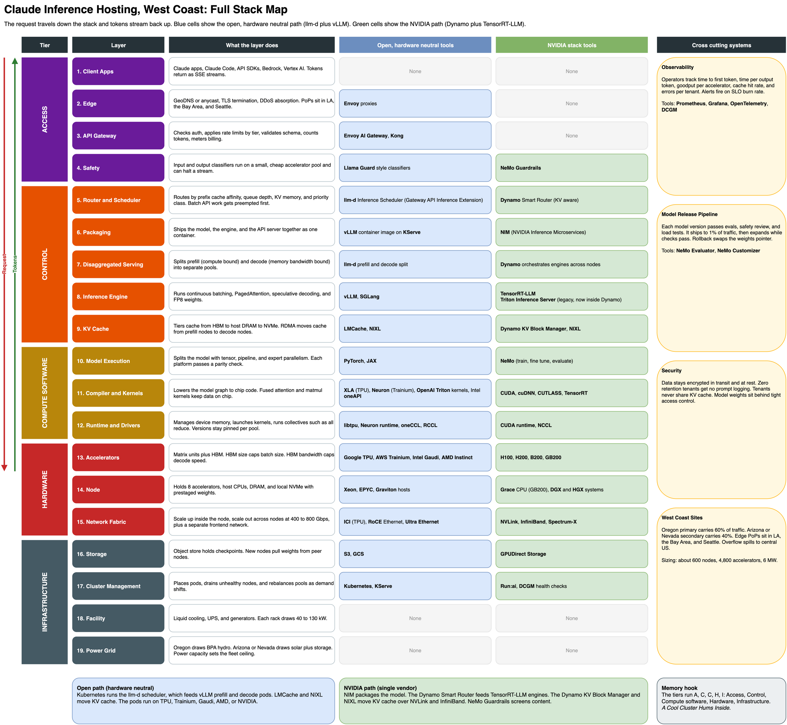

# Heterogeneous LLM inference on AWS

This project asks a practical serving question:

> Can a fast GPU handle interactive chat while a slower CPU handles background RAG work, so that long prompts do not make chat users wait?

To answer it, I built and benchmarked a small production-shaped inference service on AWS. The service ran the same model on two kinds of compute, put both behind a router, generated controlled traffic, and measured latency, throughput, capacity, and cost.

The most important result was clear: **a small amount of long-prompt RAG traffic severely disrupted interactive chat when both shared the GPU. Routing the RAG work to the CPU restored most of the chat performance.** The CPU was not faster or cheaper per token; it was useful because it isolated a different workload.

[Open the interactive stack explainer](docs/index.html) to follow a request through the system, compare Intel, NVIDIA, and AMD stacks, or build a reference architecture step by step.

---

## What this project contains

There are three related pieces:

| Piece | Purpose |
|---|---|
| **AWS experiment** | Measures how GPU, CPU, routing, batching, KV cache, and mixed workloads behave with real requests. This README explains it. |
| **Interactive stack explainer** | Shows how gateways, routers, engines, runtimes, accelerators, networking, and operations fit together. [Open it](docs/index.html). |
| **Inference Atlas** | Turns these ideas into a capacity-planning application. It estimates memory, speed, latency, and cost for other models and hardware. [Run the app](app/README.md). |

The experiment produces evidence. The explainer makes the architecture legible. The planner helps apply the same reasoning to a new service.

## The system we built

Both nodes served `Qwen/Qwen2.5-1.5B-Instruct` in BF16 with vLLM 0.29.0 and a maximum sequence length of 4,096 tokens.

```text
                       OpenAI-compatible API
                                │
                         LiteLLM router
                         /              \
              qwen-fast /                \ qwen-batch
                       /                  \
        NVIDIA L4 GPU node          Intel CPU node
        AWS g6.xlarge               AWS c7i.4xlarge
        interactive chat            background RAG
        vLLM + CUDA                 vLLM CPU + AMX
```

| Layer | Implementation | Why it is here |
|---|---|---|
| Model | Qwen2.5 1.5B Instruct, BF16 | Small enough to test cheaply on both GPU and CPU |
| Inference engine | vLLM 0.29.0 | Provides continuous batching, PagedAttention, streaming, metrics, and an OpenAI-compatible API |
| Fast pool | `g6.xlarge`, NVIDIA L4 24 GB | Serves latency-sensitive interactive chat |
| Batch pool | `c7i.4xlarge`, Intel Sapphire Rapids | Serves slower, long-prompt background work |
| Router | LiteLLM | Exposes one API and maps a model name to the correct backend |
| Network | Private VPC traffic on port 8000 | Keeps backend traffic off the public internet |
| Benchmark client | `vllm bench serve` and project scripts | Sends repeatable request shapes at controlled arrival rates |

This is a small experiment, not a production deployment. A production version would place the router and load generators on separate compute, run multiple replicas across Availability Zones, add autoscaling and health-based routing, and persist observability data.

### Full inference stack map

The experiment above implements a small subset of the complete serving stack. This diagram shows where that subset fits—from client access and routing down through the engine, runtime, hardware, cluster, and facility layers.

[](docs/assets/claude-inference-stack.svg)

Click the diagram to open the scalable version. The editable source is [`claude-inference-stack.drawio`](claude-inference-stack.drawio).

## What we measured

The project uses two request shapes because they stress the system differently.

| Workload | Input | Output | What it represents | Main pressure |
|---|---:|---:|---|---|
| **Chat** | 256 tokens | 128 tokens | Interactive conversation | Fast first token and smooth streaming |
| **RAG** | 2,048 tokens | 256 tokens | Document or retrieved-context question | Heavy prefill and larger KV cache |

The service-level objective (SLO) was:

- p99 time to first token (TTFT) ≤ 1 second
- p99 inter-token latency (ITL) ≤ 100 milliseconds

`p99` means 99% of requests were faster than that value; the slowest 1% were worse. An SLO uses tail latency because averages can look healthy while some users wait many seconds.

### The metrics in plain language

| Metric | What the user experiences | What usually makes it worse |
|---|---|---|
| **TTFT** | Delay before the first word appears | Queueing and long prompt processing |
| **ITL** | Gap between streamed words or tokens | Large batches and other requests' prefills |
| **Output tokens/s** | Total serving throughput across all users | Rises with batching until the server saturates |
| **Capacity at SLO** | Highest sustained request rate that remains fast enough | The useful production capacity, also called goodput |
| **$/1M output tokens** | Compute cost divided by delivered output | Falls with utilization, but only meaningful when latency still meets the SLO |

## Experiment sequence

Each experiment answers one question needed to understand the final architecture.

| Experiment | Question | Comparison | Main finding |
|---|---|---|---|
| 1. Engine | Does vLLM help compared with plain Hugging Face generation? | HF `generate()` vs vLLM on the L4 | vLLM delivered 1.64–1.77× more output tokens/s across tested batches. |
| 2. GPU load sweep | How much chat traffic can the L4 sustain? | Increasing open-loop request rates | Sustained capacity was 34 chat req/s at the SLO. |
| 3. Long-prompt sweep | What happens when prompts grow from 256 to 2,048 tokens? | Chat vs RAG shape | RAG missed the strict ITL target even at the lowest tested GPU rate. |
| 4. Scheduler tuning | Is capacity limited by KV memory or scheduling? | KV pool sizes and `max-num-seqs` | Halving the KV pool did not affect chat; limiting the scheduler to 16 sequences cut throughput 4.7×. |
| 5. CPU sweep | Can the CPU serve the same model, and where does it fit? | CPU chat and RAG rates | It worked, but no tested row met both strict latency targets. |
| 6. Router overhead | What does one routing hop cost? | Direct vLLM vs LiteLLM | About 17 ms additional p50 TTFT; no measurable throughput or median ITL loss. |
| 7. Mixed workload | Does CPU offload protect chat from background RAG? | RAG on shared GPU vs RAG on CPU | Chat p99 TTFT improved from 24.7 s to 289 ms. |

The chronological commands, instance details, deviations, and raw tables remain in [RUNLOG.md](RUNLOG.md). Raw benchmark JSON is in [`results/`](results/), logs are in [`logs/`](logs/), and the execution plan is in [PLAN.md](PLAN.md).

## Results that matter

### 1. vLLM improved engine throughput

The engine comparison generated 128 new tokens per request with identical prompts and prefix caching disabled.

| Batch size | Hugging Face | vLLM | vLLM speedup |
|---:|---:|---:|---:|
| 1 | 43.2 tok/s | 75.6 tok/s | 1.75× |
| 8 | 333.0 tok/s | 588.0 tok/s | 1.77× |
| 32 | 1,286.6 tok/s | 2,115.4 tok/s | 1.64× |

What this means: serving software matters even when the model and hardware do not change. vLLM reduces execution overhead and schedules active requests continuously. This experiment did not show padding waste because every prompt was identical.

### 2. Sustained GPU chat capacity was 34 requests/s

The first short sweep suggested that the L4 could handle 56 req/s. That result was wrong for production planning: 300 requests at 56 req/s lasted only about five seconds, so a sustained queue did not have time to form.

The corrected sweep sent 1,500 requests per rate:

| Request rate | Output tok/s | p99 TTFT | p99 ITL | Meets SLO? |
|---:|---:|---:|---:|:---:|
| 24 req/s | 2,971 | 92 ms | 30.6 ms | Yes |
| 28 req/s | 3,441 | 113 ms | 37.4 ms | Yes |
| 32 req/s | 3,888 | 142 ms | 48.0 ms | Yes |
| **34 req/s** | **4,098** | **173 ms** | **56.6 ms** | **Yes** |
| 36 req/s | 4,148 | 1,533 ms | 70.5 ms | No |
| 38 req/s | 4,167 | 3,666 ms | 72.9 ms | No |

The saturation knee sits between 34 and 36 req/s. Throughput barely increased after that point, but p99 TTFT jumped from 173 ms to 1.5 seconds. New requests were waiting in a queue rather than creating useful capacity.

At the tested on-demand price, the 34 req/s row delivered output for about **$0.055 per million output tokens**. That is an experiment-specific compute figure, not a complete production cost: it excludes the router, storage, networking, idle headroom, observability, and multi-AZ redundancy.

### 3. Long prompts interfered with streaming

On the GPU RAG sweep, p99 ITL was already 117 ms at 1 req/s, above the 100 ms target. At 4 req/s, p99 TTFT reached 27.5 seconds and throughput had flattened near 650 output tok/s.

The reason is prefill interference. A 2,048-token prompt requires a large compute-heavy prefill. When that work shares scheduler steps with active chat decodes, every streaming request can pause. Chunked prefill reduces the pause but did not remove it under this test.

This is why a server that looks fast for short chat prompts may behave very differently for RAG, code, or agent requests. Model name and tokens per second are not enough to describe capacity; prompt length and traffic mix are part of the workload.

### 4. The chat workload was scheduler-limited, not KV-memory-limited

Halving `--gpu-memory-utilization` reduced the KV pool from 575,440 to 272,832 tokens, but warm chat performance at 56 req/s was effectively unchanged. These short requests still fit comfortably.

Setting `--max-num-seqs 16` had a large effect:

| Configuration | Saturated output tok/s | p99 TTFT | p99 ITL |
|---|---:|---:|---:|
| Baseline | 5,011 | 5,452 ms | 82.4 ms |
| 50% GPU memory utilization | 5,000 | 5,458 ms | 87.1 ms |
| Maximum 16 sequences | 1,063 | 34,272 ms | 16.9 ms |
| Maximum 256 sequences | 5,071 | 5,358 ms | 84.6 ms |

The 16-sequence cap traded throughput for smoother token streaming. Only 16 requests shared each decode step, so ITL improved, but the waiting queue grew dramatically. This is a concrete example of why optimizing one latency metric can damage another.

The tuning run also exposed a methodology problem: the first benchmark after restarting a server included model warm-up and produced p99 TTFT around 4.3 seconds, versus about 0.2 seconds after warm-up. All performance tests need an explicit warm-up and a sufficiently long measurement window.

### 5. The CPU was a useful isolation tier, not a faster inference tier

The Intel CPU node used seven physical Sapphire Rapids cores for model compute and left one core for the API server and benchmark client. Single-stream generation was about 15 tok/s after warm-up.

No tested CPU row met both strict SLO thresholds. Chat throughput saturated near 367 output tok/s, compared with roughly 4,150 tok/s on the GPU—a 14× difference. Based on the short CPU sweep, chat cost about $0.78 per million tokens at the TTFT-only capacity, versus about $0.055 on the GPU sustained chat result.

That does not make the CPU useless. It means the CPU is a poor replacement for the GPU when the goal is maximum interactive throughput. It can still be valuable for latency-tolerant work, spare already-paid-for capacity, or workload isolation.

### 6. Offloading background RAG protected interactive chat

This was the final experiment. Interactive chat ran at 24 req/s, about 70% of the measured sustained GPU capacity. Background RAG ran at 0.75 req/s.

| Run | Where background RAG ran | Chat p99 TTFT | Chat p99 ITL | Chat output tok/s |
|---|---|---:|---:|---:|
| Chat alone | No background load | 91 ms | 30.2 ms | 2,971 |
| A: shared | Same GPU as chat | **24,702 ms** | **203.7 ms** | 2,009 |
| B: offloaded | CPU through LiteLLM | **289 ms** | **112.0 ms** | 2,942 |

Moving RAG to the CPU changed chat p99 TTFT from 24.7 seconds to 289 ms—an 85× improvement—and restored throughput close to the chat-only result. p99 ITL improved from 204 ms to 112 ms.

Run B was still worse than chat alone and narrowly missed the 100 ms ITL target. The GPU node had only four vCPUs and was also running the router and two benchmark clients, so CPU contention on that node probably contributed. This was not isolated, and each condition was run only once. The direction of the result is strong; the exact improvement needs repeated trials on a cleaner topology.

The background job itself completed more slowly on the CPU: 186 seconds versus 164 seconds on the overloaded GPU. That was the intended trade. The batch user waited a little longer so interactive users did not wait tens of seconds.

## What the experiment teaches about inference

### Prefill and decode are different workloads

An LLM request has two main phases:

1. **Prefill** reads the entire prompt in parallel and creates the first token plus the initial KV cache. It is mostly compute-bound.
2. **Decode** generates one token at a time and repeatedly reads model weights and prior KV state. It is often memory-bandwidth-bound.

Long RAG prompts add prefill work. Many simultaneous chat streams add decode work. A production scheduler has to balance both without allowing one class to ruin the other's tail latency.

### The KV cache controls concurrency

Attention reuses keys and values from earlier tokens. vLLM stores them in a paged KV cache instead of recomputing them.

For this model:

```text
KV bytes per token = 2 × layers × KV heads × head dimension × bytes per value
                   = 2 × 28 × 2 × 128 × 2
                   = 28,672 bytes, or about 28 KB per token
```

The GPU exposed a 575,440-token KV pool at 90% memory utilization, enough for about 140 maximum-length 4,096-token requests in theory. The tested chat requests were much shorter, which is why halving the pool did not change their capacity. Long-context requests would reach the memory limit sooner.

### Batching improves throughput until queueing wins

Continuous batching lets new requests join and completed requests leave at each decode step. This is why output throughput increased from 127 tok/s at 1 chat req/s to more than 4,000 tok/s near saturation.

After the saturation knee, the server did not produce much more output. It only made new requests wait. Production capacity should therefore be measured at an SLO, not at the highest raw tokens/s observed during overload.

## Translating this into an AWS inference service

The experiment maps to a production design as follows:

| Experiment component | Production AWS role | What to add for production |
|---|---|---|
| LiteLLM on one instance | Model gateway and workload router | Dedicated ECS/EKS service or instances, multiple replicas, health checks, authentication, rate limits |
| L4 `g6.xlarge` | Interactive inference pool | Auto Scaling Group or EKS node group across AZs; scale on queue depth, TTFT, and running requests |
| Sapphire Rapids `c7i.4xlarge` | Background or overflow pool | Queue-based workers, interruption-tolerant jobs, possibly Spot when retryable |
| vLLM API | Model-serving container | ECR images pinned by version, readiness/startup probes, controlled rollouts |
| Security-group-to-security-group rule | Private service-to-service traffic | Private subnets, load balancers or service discovery, least-privilege rules, VPC endpoints where useful |
| Local benchmark scripts | Pre-production load test | Repeatable CI or release gate using production request distributions |
| `/metrics` endpoint | Service telemetry | Amazon Managed Service for Prometheus, CloudWatch, Grafana, traces, SLO alerts |
| Local model download | Weight distribution | S3 or model registry, local NVMe cache, controlled model release pipeline |

A sensible routing policy would separate work by service objective rather than hardware name:

- Interactive chat and user-facing agents go to the fast pool.
- Batch summarization, evaluation, document processing, and other delay-tolerant jobs go to the background pool.
- Very long or high-priority prompts can have their own queue or prefill pool.
- The router rejects, queues, or sheds load when all pools are beyond their SLO capacity.

The CPU tier is only one option. A production system might use a cheaper GPU pool, AWS Inferentia, Spot GPUs, or separate prefill and decode workers. The transferable lesson is to isolate workload classes whose performance goals and resource profiles conflict.

## What is measured, calculated, and still uncertain

| Type | Examples in this project | How to use it |
|---|---|---|
| **Measured** | TTFT, ITL, throughput, KV pool, engine comparison, router overhead | Evidence for this model, software version, instance type, and request shape |
| **Calculated from measurements** | $/1M output tokens, 70% load point, speedup ratios | Useful if the inputs and pricing assumptions remain valid |
| **Estimated** | Roofline ceilings and some theoretical bandwidth/compute explanations | Sanity checks, not capacity commitments |

Important limits:

- One small model and one precision were tested.
- The final mixed-workload conditions were not repeated.
- CPU sweep runs were short, so their reported capacities are upper bounds.
- The router shared a four-vCPU GPU host with other processes.
- Network traffic stayed inside one VPC and one AWS Region (`us-east-2`).
- The experiment did not test autoscaling, multi-AZ failover, rolling deployment, or sustained observability.
- AWS prices in the run log are the prices used during the experiment, not current quotes.

Do not transfer a tokens/s number directly to another model or instance. Transfer the method: define the workload, warm the server, generate sustained open-loop traffic, find the saturation knee, and report the highest rate that still meets the user-facing SLO.

## Reproduce or inspect the work

| Path | What to read |
|---|---|
| [RUNLOG.md](RUNLOG.md) | Chronological record, complete result tables, AWS resources, and deviations |
| [PLAN.md](PLAN.md) | Execution plan and validation gates |
| [`scripts/`](scripts/) | Engine comparison, sweeps, tuning, router, and offload scripts |
| [`results/`](results/) | Raw JSON measurements and saved analysis |
| [`logs/`](logs/) | Server, benchmark, cache, and tuning logs |
| [`analyze.py`](analyze.py) | Capacity-at-SLO and cost calculations |
| [`docker-compose.yml`](docker-compose.yml) | Local Prometheus and Grafana stack |
| [`app/`](app/) | Inference Atlas capacity planner |

The full-stack source diagrams are also available as a [draw.io file](claude-inference-stack.drawio) and a [NotebookLM mind map](NotebookLM%20Mind%20Map.png).

## Further reading

- Kwon et al., *Efficient Memory Management for Large Language Model Serving with PagedAttention* (SOSP 2023)
- Yu et al., *Orca: A Distributed Serving System for Transformer-Based Generative Models* (OSDI 2022)
- Agrawal et al., *Sarathi-Serve* (OSDI 2024), on chunked prefill and latency/throughput tradeoffs
- Zhong et al., *DistServe* (OSDI 2024), and Patel et al., *Splitwise* (ISCA 2024), on prefill/decode disaggregation
- vLLM documentation for serving, benchmarking, CPU installation, and metrics
